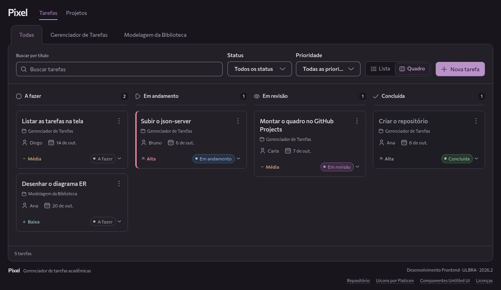
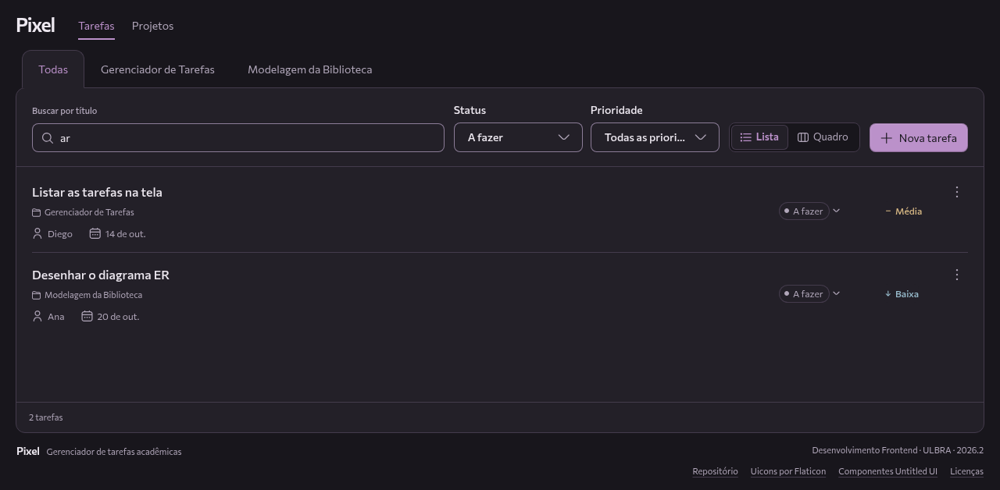
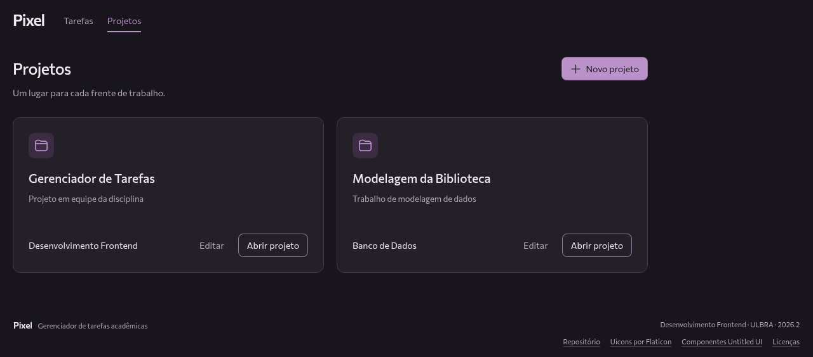
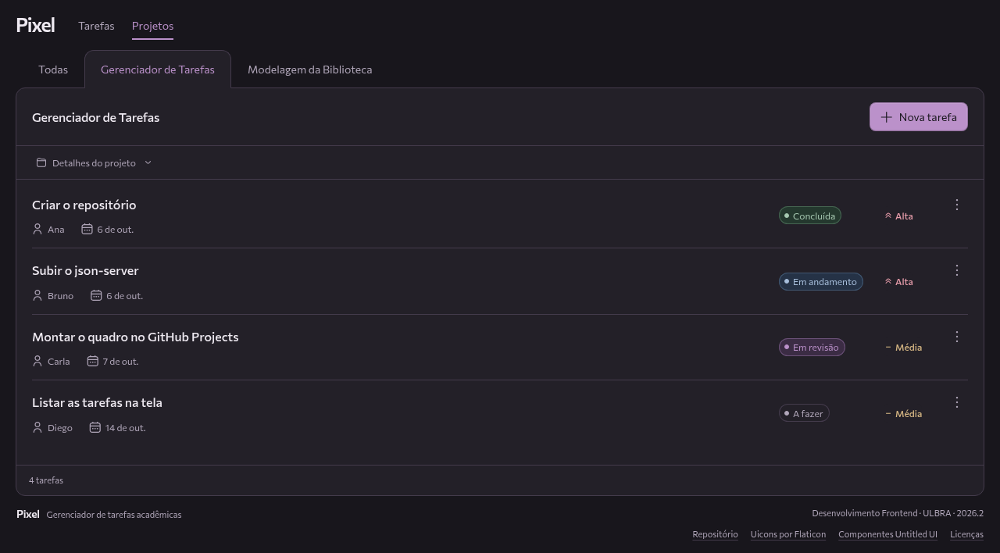
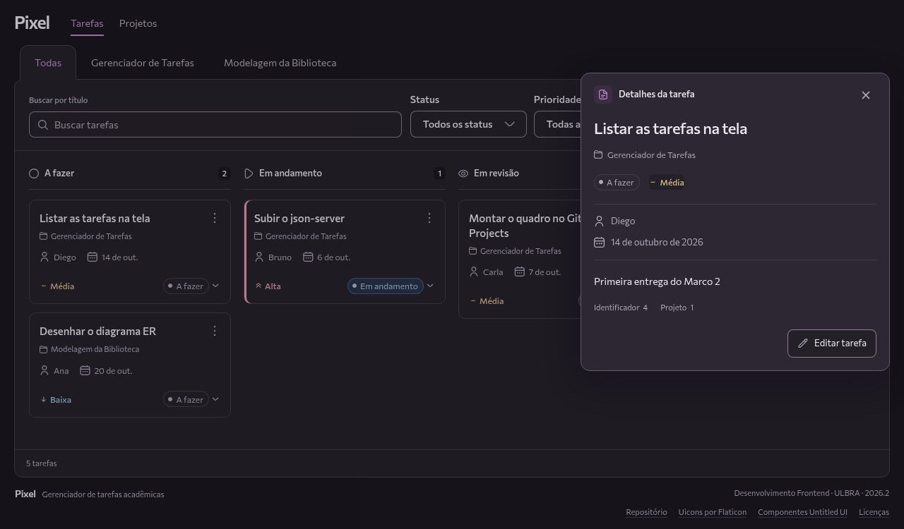
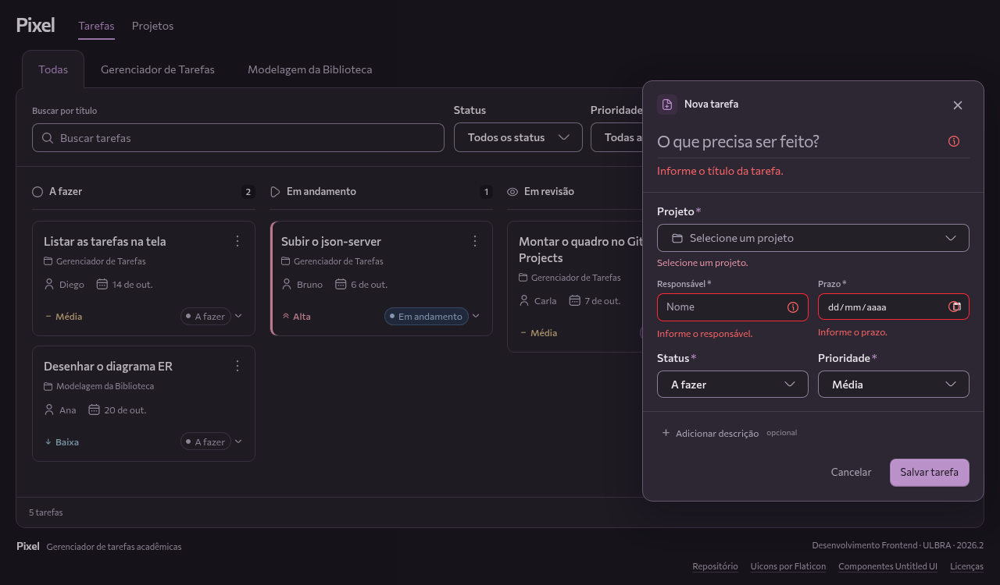
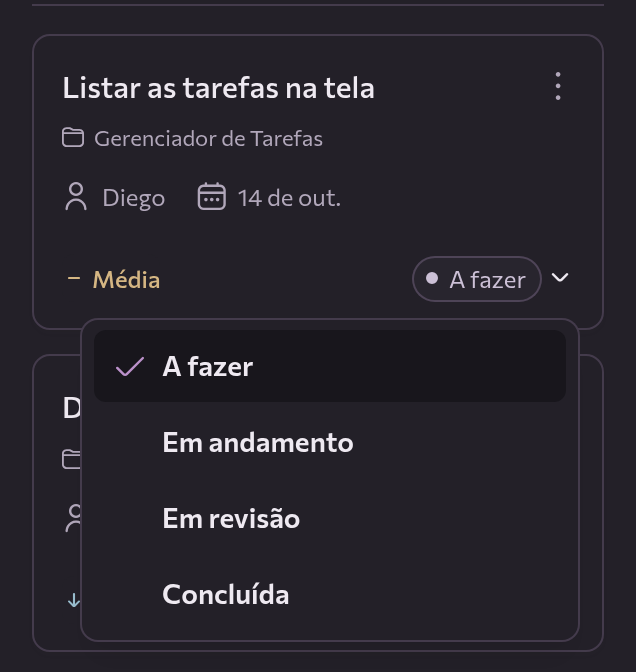

# Pixel

Organize projetos e tarefas em um só lugar. Crie, edite e acompanhe status, prioridades, responsáveis e prazos.



<details>
<summary>Lista com busca e filtros</summary>



</details>

<details>
<summary>Projetos e página do projeto</summary>





</details>

<details>
<summary>Detalhe e cadastro em fichas</summary>





</details>

<details>
<summary>Mudança de status pelo selo do cartão</summary>



</details>

## Como rodar

Requer **Node.js 24 ou superior**, com npm. Na pasta do projeto:

```bash
npm ci
```

Em um terminal, inicie a API em `http://localhost:3000`:

```bash
npx json-server db.json
```

Em outro terminal, na mesma pasta, inicie a aplicação:

```bash
npm run dev
```

Abra o endereço mostrado pelo Vite, normalmente `http://localhost:5173`. Mantenha os dois terminais abertos.

Para verificar o TypeScript e gerar os arquivos de produção em `dist/`:

```bash
npm run build
```

**Framework:** React com TypeScript.

## Equipe

Projeto da disciplina **Desenvolvimento Frontend**, ULBRA — 2026.2.

- Gabriela de Araújo Reis
- Euclides Carlos Pilon Neto
- Linnek Lima de Araujo

[Créditos e licenças](public/design-licenses/THIRD_PARTY_NOTICES.txt)
